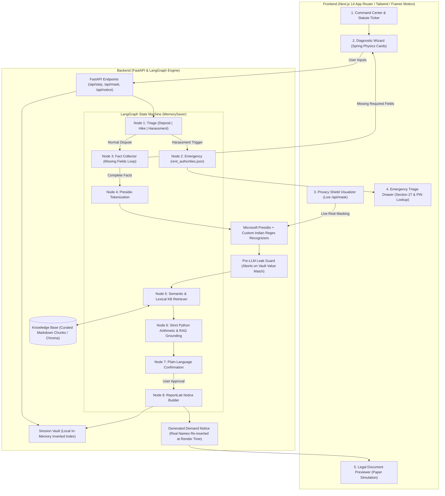

# Namma Tenant Navigator (ನಮ್ಮ ಟೆನೆಂಟ್ ನ್ಯಾವಿಗೇಟರ್)

> **Agentic AI Legal Aid & Tenant Rights Engine for Urban Renters in Bengaluru**  
> Grounded in the **Karnataka Rent Act, 1999**, **Transfer of Property Act, 1882**, and the **Model Tenancy Framework**.  
> Features zero-clutter Apple-grade minimalism (`#0A0A0A` matte charcoal, spring physics, glassmorphism) paired with a deterministic, privacy-first local Python backend.

---

## Architecture Diagram



---

## 5 Core UI Modules

1. **Command Center (Landing)**: Typography-led hero with a dynamic statutory ticker reading directly from the Knowledge Base, leading to the primary action: *"Evaluate Your Lease"*.
2. **Diagnostic Wizard**: Card interface morphing with spring physics between steps. Gathers dispute facts one question at a time (monthly rent, deposit paid, deduction reasons, move-out dates, 90-day rent hike notice timelines).
3. **Privacy Shield Visualizer**: Real-time side-by-side demonstration calling the live `/api/mask` endpoint. Displays how tenant names, phone numbers, Bengaluru addresses, and PIN codes are converted into stable tokens (`[TENANT_NAME]`, `[PROPERTY_ADDRESS]`, `[PHONE_1]`) before any prompt dispatch.
4. **Legal Document Previewer**: Paper-like document modal simulating a physical Demand Notice with formal letterhead, factual recitals, statutory violations, specific demand, and instant PDF download.
5. **Emergency Triage Drawer**: Immediate slide-over triggered by distress keywords (*power cut, water cut, lock-out, threats, harassment*). Displays the local Rent Control Authority contact by PIN code, helplines (*Police 112, BESCOM 1912, BWSSB 1916*), and Section 27 protections.

---

## Setup & Execution Commands

### Prerequisites
- Python 3.11+ (Python 3.12 verified)
- Node.js 18+ (Node v22 verified)

### 1. Backend Setup
```powershell
# Navigate to backend and activate venv
cd d:\agenticai\backend
.\venv\Scripts\Activate.ps1

In mac:
cd backend
source backend/.venv/bin/activate

# Install dependencies (if not already installed)
pip install -r requirements.txt

# Run FastAPI backend server (Port 8000)
uvicorn backend.main:app --host 0.0.0.0 --port 8000 --reload
```

### 2. Frontend Setup
```powershell
# Navigate to frontend in a new terminal
cd d:\agenticai\frontend

# Install node dependencies
npm install

# Start Next.js development server (Port 3000)
npm run dev
```

Visit `http://localhost:3000` in your browser.

---

## Running the Automated Test Suite

```powershell
# From project root with venv activated
python -m pytest backend/tests/ -v
```

The test suite validates:
- **Masker Verification**: PII removed (names, phones, Bengaluru addresses, PIN codes), amounts (`₹2,10,000`) and dates (`15-08-2024`) survive untouched, stable placeholders maintained across requests.
- **Privacy Leak Guard**: Pre-dispatch scanner raises `PrivacyLeakException` and aborts if any raw vault value appears in the outgoing model payload.
- **Retriever Strictness**: Returns accurate citations (`KB-DEP-001`, `KB-WTR-002`) for tenancy queries; returns 0 results for unrelated queries.
- **Emergency Routing**: Distress queries bypass document generation and route directly to emergency contact lookups.
- **Fact Validation Loop**: Missing deposit or hike fields trigger follow-up questions instead of prematuring notice generation.
- **Citation Rejection**: Any hallucinated or invalid citation ID is rejected from final analysis.
- **PDF Generation**: End-to-end rendering of advocate-ready PDF notices via ReportLab.

---

## Generating the Fake Scenario Sample PDF

To generate `examples/sample_notice.pdf` for a realistic Bengaluru deposit dispute scenario:
```powershell
python examples/generate_sample.py
```

---

## Manual Verification & Legal To-Do Checklist

> [!WARNING]
> While the system enforces strict deterministic arithmetic and privacy masking, statutory chunks and directory records are intentionally marked with `verified: false` until authenticated by legal counsel.

- [ ] **Fill Verified Law Text**:
  - Open `kb/deposit_limits_and_refund.md`, `kb/wear_and_tear_vs_damage.md`, `kb/rent_increase_notice.md`, `kb/utility_cutoff_harassment.md`.
  - Replace `TODO: paste verified text` blocks with certified verbatim gazette excerpts from Karnataka State Gazette or India Code.
  - Set `verified: true` in the YAML frontmatter.
- [ ] **Fill Verified Rent Authority Contacts**:
  - Open `backend/data/rent_authorities.json`.
  - Add official phone numbers and email addresses for Assistant Commissioners / Rent Controllers across all Bengaluru sub-divisions (North, South, East, Anekal, Yelahanka).
- [ ] **Enrolled Advocate Legal Review**:
  - Have an advocate enrolled with the Karnataka State Bar Council review the demand notice templates and statutory citations before serving notices upon landlords.
