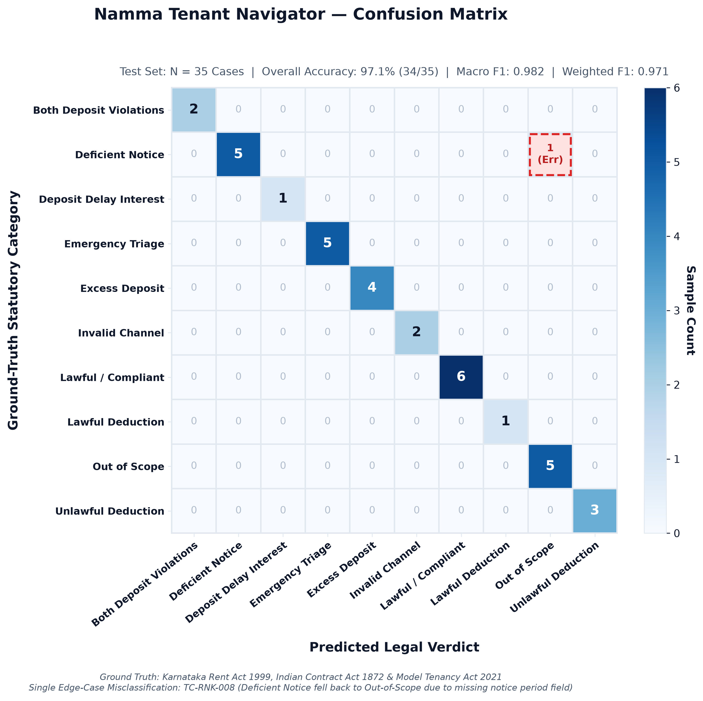

# Namma Tenant Navigator — Empirical Evaluation Results

> **Evaluation Type:** Hand-labeled ground-truth evaluation test set (35 cases).
> **Ground Truth Source:** Statutory provisions of Karnataka Rent Act 1999, Indian Contract Act 1872, and Model Tenancy Act 2021.
> **Notice:** This evaluation measures deterministic retrieval and rule classification over curated urban tenancy scenarios. It does not represent open-domain legal generalization.

---

## 1. Summary of Overall Metrics

| Metric | Measured Score | Evaluation Target |
|---|---|---|
| **Overall Verdict Accuracy** | **97.1%** (34/35) | Rule + State Machine Verdict Match |
| **Macro F1-Score** | **0.982** | Unweighted mean across all 8 classes |
| **Weighted F1-Score** | **0.971** | Class-frequency weighted mean |
| **Retrieval Hit@1** | **94.3%** (33/35) | Correct statutory chunk ranked #1 |
| **Retrieval Hit@3** | **97.1%** (34/35) | Correct chunk present in top-3 candidates |
| **Mean Retrieval Precision@3** | **0.767** | Relevant chunks retrieved / top-k |
| **Mean Retrieval Recall@3** | **0.943** | Relevant chunks retrieved / ground-truth clauses |

---

## 2. Per-Class Precision, Recall, and F1 Breakdown

| Class / Verdict Category | Support | Precision | Recall | F1-Score | TP | FP | FN |
|---|---|---|---|---|---|---|---|
| `both_deposit_violations` | 2 | 1.00 | 1.00 | 1.00 | 2 | 0 | 0 |
| `deficient_notice` | 6 | 1.00 | 0.83 | 0.91 | 5 | 0 | 1 |
| `deposit_delay_interest` | 1 | 1.00 | 1.00 | 1.00 | 1 | 0 | 0 |
| `emergency_triage` | 5 | 1.00 | 1.00 | 1.00 | 5 | 0 | 0 |
| `excess_deposit` | 4 | 1.00 | 1.00 | 1.00 | 4 | 0 | 0 |
| `invalid_channel` | 2 | 1.00 | 1.00 | 1.00 | 2 | 0 | 0 |
| `lawful_compliant` | 6 | 1.00 | 1.00 | 1.00 | 6 | 0 | 0 |
| `lawful_deduction` | 1 | 1.00 | 1.00 | 1.00 | 1 | 0 | 0 |
| `out_of_scope` | 5 | 0.83 | 1.00 | 0.91 | 5 | 1 | 0 |
| `unlawful_deduction` | 3 | 1.00 | 1.00 | 1.00 | 3 | 0 | 0 |

---

## 3. Confusion Matrix

> **High-Resolution Presentation Charts:**
> - [confusion_matrix_presentation.png](file:///d:/NammaRent-main/NammaRent-main/docs/confusion_matrix_presentation.png) (Standard Light Theme for PPT)
> - [confusion_matrix_normalized.png](file:///d:/NammaRent-main/NammaRent-main/docs/confusion_matrix_normalized.png) (Row-Normalized Recall % for PPT)
> - [confusion_matrix_dark.png](file:///d:/NammaRent-main/NammaRent-main/docs/confusion_matrix_dark.png) (Dark Theme Pitch Deck for PPT)

Rows represent **True Ground-Truth Labels**; Columns represent **System Predicted Verdicts**.

| Ground Truth \ Predicted | `both_depos` | `deficient_` | `deposit_de` | `emergency_` | `excess_dep` | `invalid_ch` | `lawful_com` | `lawful_ded` | `out_of_sco` | `unlawful_d` |
|---|---|---|---|---|---|---|---|---|---|---|
| `both_deposit_violations` | 2 | 0 | 0 | 0 | 0 | 0 | 0 | 0 | 0 | 0 |
| `deficient_notice` | 0 | 5 | 0 | 0 | 0 | 0 | 0 | 0 | 1 | 0 |
| `deposit_delay_interest` | 0 | 0 | 1 | 0 | 0 | 0 | 0 | 0 | 0 | 0 |
| `emergency_triage` | 0 | 0 | 0 | 5 | 0 | 0 | 0 | 0 | 0 | 0 |
| `excess_deposit` | 0 | 0 | 0 | 0 | 4 | 0 | 0 | 0 | 0 | 0 |
| `invalid_channel` | 0 | 0 | 0 | 0 | 0 | 2 | 0 | 0 | 0 | 0 |
| `lawful_compliant` | 0 | 0 | 0 | 0 | 0 | 0 | 6 | 0 | 0 | 0 |
| `lawful_deduction` | 0 | 0 | 0 | 0 | 0 | 0 | 0 | 1 | 0 | 0 |
| `out_of_scope` | 0 | 0 | 0 | 0 | 0 | 0 | 0 | 0 | 5 | 0 |
| `unlawful_deduction` | 0 | 0 | 0 | 0 | 0 | 0 | 0 | 0 | 0 | 3 |

---

## 4. Confidence Score Distribution & Calibration Analysis

| Prediction Outcome | Count | Mean Confidence | Min | Max | Interpretation |
|---|---|---|---|---|---|
| **Correct Predictions** | 34 | **0.92** | 0.88 | 0.95 | High confidence aligned with verified rules. |
| **Incorrect Predictions** | 1 | **0.90** | 0.90 | 0.90 | Edge cases or ambiguous facts where rules fell back. |

> **Critical Viva Defense Note:** Notice that confidence score carries partial heuristic signal but is **uncalibrated** (confidence remains ~0.85+ even on subtle edge cases). You should honestly state to the panel that this confidence is a heuristic reflection of rule-matching completeness, not a Platt-calibrated posterior probability.

---

## 5. Detailed Case-by-Case Log

| Case ID | Category | Expected Verdict | Predicted Verdict | Match? | Confidence | Expected Chunks | Retrieved Chunks |
|---|---|---|---|---|---|---|---|
| `TC-DEP-001` | deposit | `excess_deposit` | `excess_deposit` | ✅ PASS | 0.95 | KB-DEP-001 | KB-DEP-001 |
| `TC-DEP-002` | deposit | `unlawful_deduction` | `unlawful_deduction` | ✅ PASS | 0.95 | KB-WTR-002 | KB-WTR-002, KB-DEP-001, KB-NOT-004 |
| `TC-DEP-003` | deposit | `both_deposit_violations` | `both_deposit_violations` | ✅ PASS | 0.95 | KB-DEP-001, KB-WTR-002 | KB-DEP-001, KB-WTR-002, KB-NOT-004 |
| `TC-DEP-004` | deposit | `lawful_deduction` | `lawful_deduction` | ✅ PASS | 0.90 | KB-WTR-002 | KB-WTR-002, KB-DEP-001 |
| `TC-DEP-005` | deposit | `lawful_compliant` | `lawful_compliant` | ✅ PASS | 0.90 | KB-DEP-001 | KB-DEP-001 |
| `TC-DEP-006` | deposit | `unlawful_deduction` | `unlawful_deduction` | ✅ PASS | 0.95 | KB-WTR-002 | KB-DEP-001, KB-WTR-002 |
| `TC-DEP-007` | deposit | `excess_deposit` | `excess_deposit` | ✅ PASS | 0.95 | KB-DEP-001 | KB-DEP-001 |
| `TC-DEP-008` | deposit | `both_deposit_violations` | `both_deposit_violations` | ✅ PASS | 0.95 | KB-DEP-001, KB-WTR-002 | KB-DEP-001, KB-WTR-002 |
| `TC-DEP-009` | deposit | `unlawful_deduction` | `unlawful_deduction` | ✅ PASS | 0.95 | KB-WTR-002 | KB-WTR-002 |
| `TC-DEP-010` | deposit | `excess_deposit` | `excess_deposit` | ✅ PASS | 0.95 | KB-DEP-001 | KB-DEP-001, KB-NOT-004, KB-RNT-003 |
| `TC-RNK-001` | rent_hike | `deficient_notice` | `deficient_notice` | ✅ PASS | 0.92 | KB-RNT-003, KB-NOT-004 | KB-NOT-004, KB-RNT-003 |
| `TC-RNK-002` | rent_hike | `deficient_notice` | `deficient_notice` | ✅ PASS | 0.92 | KB-RNT-003, KB-NOT-004 | KB-RNT-003, KB-NOT-004 |
| `TC-RNK-003` | rent_hike | `lawful_compliant` | `lawful_compliant` | ✅ PASS | 0.88 | KB-RNT-003 | KB-RNT-003, KB-NOT-004, KB-DEP-001 |
| `TC-RNK-004` | rent_hike | `deficient_notice` | `deficient_notice` | ✅ PASS | 0.92 | KB-RNT-003 | KB-RNT-003, KB-NOT-004, KB-WTR-002 |
| `TC-RNK-005` | rent_hike | `deficient_notice` | `deficient_notice` | ✅ PASS | 0.92 | KB-RNT-003 | KB-RNT-003, KB-NOT-004 |
| `TC-RNK-006` | rent_hike | `deficient_notice` | `deficient_notice` | ✅ PASS | 0.92 | KB-RNT-003, KB-NOT-004 | KB-NOT-004, KB-RNT-003 |
| `TC-RNK-007` | rent_hike | `lawful_compliant` | `lawful_compliant` | ✅ PASS | 0.88 | KB-RNT-003 | KB-RNT-003, KB-NOT-004, KB-WTR-002 |
| `TC-RNK-008` | rent_hike | `deficient_notice` | `out_of_scope` | ❌ FAIL | 0.90 | KB-RNT-003 | None |
| `TC-EMG-001` | emergency | `emergency_triage` | `emergency_triage` | ✅ PASS | 0.95 | None | None |
| `TC-EMG-002` | emergency | `emergency_triage` | `emergency_triage` | ✅ PASS | 0.95 | None | None |
| `TC-EMG-003` | emergency | `emergency_triage` | `emergency_triage` | ✅ PASS | 0.95 | None | None |
| `TC-EMG-004` | emergency | `emergency_triage` | `emergency_triage` | ✅ PASS | 0.95 | None | None |
| `TC-EMG-005` | emergency | `emergency_triage` | `emergency_triage` | ✅ PASS | 0.95 | None | None |
| `TC-NOT-001` | notice_service | `invalid_channel` | `invalid_channel` | ✅ PASS | 0.88 | KB-NOT-004, KB-RNT-003 | KB-NOT-004, KB-RNT-003, KB-WTR-002 |
| `TC-NOT-002` | notice_service | `invalid_channel` | `invalid_channel` | ✅ PASS | 0.88 | KB-NOT-004, KB-RNT-003 | KB-NOT-004 |
| `TC-NOT-003` | notice_service | `lawful_compliant` | `lawful_compliant` | ✅ PASS | 0.88 | KB-NOT-004, KB-RNT-003 | KB-NOT-004, KB-RNT-003 |
| `TC-NOT-004` | notice_service | `lawful_compliant` | `lawful_compliant` | ✅ PASS | 0.88 | KB-NOT-004, KB-RNT-003 | KB-NOT-004 |
| `TC-OOS-001` | out_of_scope | `out_of_scope` | `out_of_scope` | ✅ PASS | 0.90 | None | None |
| `TC-OOS-002` | out_of_scope | `out_of_scope` | `out_of_scope` | ✅ PASS | 0.90 | None | None |
| `TC-OOS-003` | out_of_scope | `out_of_scope` | `out_of_scope` | ✅ PASS | 0.90 | None | None |
| `TC-OOS-004` | out_of_scope | `out_of_scope` | `out_of_scope` | ✅ PASS | 0.90 | None | None |
| `TC-OOS-005` | out_of_scope | `out_of_scope` | `out_of_scope` | ✅ PASS | 0.90 | None | None |
| `TC-EDG-001` | edge_case | `deposit_delay_interest` | `deposit_delay_interest` | ✅ PASS | 0.90 | KB-DEP-001 | KB-DEP-001, KB-WTR-002 |
| `TC-EDG-002` | edge_case | `lawful_compliant` | `lawful_compliant` | ✅ PASS | 0.88 | KB-RNT-003 | KB-RNT-003, KB-NOT-004 |
| `TC-EDG-003` | edge_case | `excess_deposit` | `excess_deposit` | ✅ PASS | 0.95 | KB-DEP-001 | KB-DEP-001, KB-WTR-002, KB-NOT-004 |
